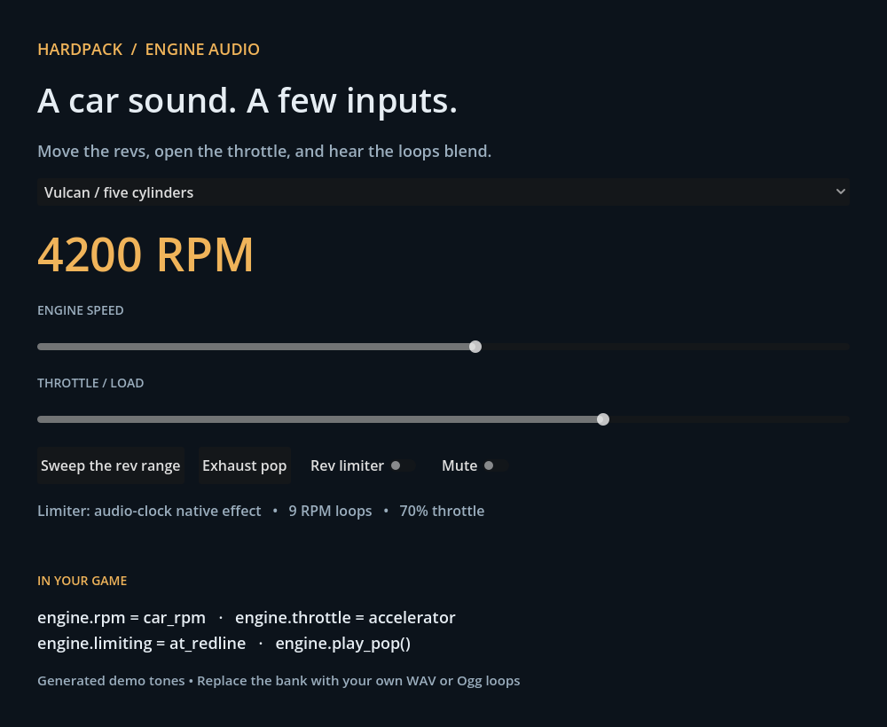

# Hardpack Engine Audio

Small, readable engine audio for **Godot 4.7+**. Give it RPM and throttle; it pitches and blends engine loops, softens the tone on lift-off, and plays rev-limiter cuts and exhaust pops.

Extracted and simplified from **Hardpack Rally**. No vehicle physics, autoloads, game assets or third-party Godot plugins required.

## Try it in a minute

1. [Download the latest release](https://github.com/LittleTOPcreations/hardpack-engine-audio/releases/latest), or download this repository as a ZIP.
2. Unzip it and import `project.godot` in Godot **4.7.2** (the tested version).
3. Press **F5**. Choose a voice, move the RPM and throttle sliders, and try the limiter and pop buttons.

The demo includes three generated voices: a four-cylinder, a five-cylinder and an eight-cylinder, plus six synthetic exhaust pops. **These demonstrate the system; they are not the current game's recorded car sounds.** Rust and Python are not needed to use them.



## Add it to your game

1. Copy `addons/engine_audio` into your project. Copy `demo/audio` and `demo/banks` too if you want the included sounds; keep those paths intact.
2. Add an **EngineAudioPlayer** node as a child of your car.
3. Drag `demo/banks/vulcan.tres` into its **Bank** field in the Inspector.
4. Feed it your car's values:

```gdscript
@onready var engine: EngineAudioPlayer = $EngineAudioPlayer

func _physics_process(_delta: float) -> void:
    engine.rpm = car_rpm            # Actual RPM: e.g. 3200, not 0..1.
    engine.throttle = accelerator   # 0..1; controls brightness and level.
    engine.limiting = at_rev_limit  # Your physics decides when this is true.

func on_exhaust_event() -> void:
    engine.play_pop()               # Optional; strength is 0..1.
```

Use an active Camera3D or AudioListener3D near the car. The sound is spatial; `unit_size` controls how far away it remains loud. Each player creates and cleans up its own audio buses, so cars can have different throttle filters and limiters.

Set `enabled = false` to mute and clear pops, `volume_db` to adjust the whole engine, and call `reset()` after a replay seek or respawn. Godot scene-tree pause also pauses its audio players. Assign a different `bank` to switch engines. Treat bank resources as immutable while playing; call `reload_bank()` after editing their contents at runtime.

## Use your own recordings

A bank is just a Resource containing matching **Loops** and **RPMs** arrays, plus idle/redline, blend width, gain and optional pops.

1. Prepare steady, seamless WAV or Ogg loops at several known RPMs. Prefer mono for spatial sound; match their perceived loudness.
2. In Godot, create an **EngineAudioBank** resource. Add each loop and its RPM in ascending order. RPMs must be positive and unique.
3. Set idle/redline, assign the bank to the player, and listen through a slow sweep.

Start with `blend = 1.2`. Use `0` for a crossfade between only the nearest two loops. More overlap can smooth tone changes, but cannot fix a click within a loop or mismatched recordings. Playback automatically loops the full file; trim files to their intended loop region first. Pops play as one-shots regardless of import loop flags.

Optional shortcut for a folder of files named `900.wav`, `2000.wav`, etc.:

```sh
python tools/make_bank.py my_audio my_bank.tres --idle 900 --redline 7000
```

Paths must be within this project. The script uses only Python's standard library. You can also create banks entirely in the Inspector.

## Which limiter should I use?

**The default addon works without native code.** Its limiter follows the same 180 ms envelope as the game, but updates with rendered frames. At low frame rates or during a stall, its short cuts will be less accurate.

**The optional native addon applies the cuts on the audio thread.** It preserves the game's precise timing even when the scene stalls. The Windows x64 release includes it already installed; its demo status line confirms the active mode. The portable release/source ZIP uses the frame-timed version. No game DLL is included.

Native source is in `native/`. [Build/install instructions](docs/native.md) cover Windows, Linux and macOS. Only Windows x64 binaries are supplied in the initial release. Mobile and Web native builds are outside this release's scope.

## What is included?

| Location | Purpose |
|---|---|
| `addons/engine_audio/engine_audio_bank.gd` | Bank validation and log-RPM blend weights |
| `addons/engine_audio/engine_audio_player.gd` | Playback, throttle filter, limiter, pop voices and bus lifetime |
| `demo/` | A runnable sound bench with generated example banks |
| `native/` | Optional Rust audio-clock limiter |
| `tools/voice-bank/` | Optional offline procedural engine/pop generator |
| `tests/` | Blend, lifecycle, isolation and actual mixer checks |

The runtime deliberately leaves gear selection, overrun scheduling, turbo, suspension pitch effects, replay and camera effects to your game. `play_pop()` lets your own events drive exhaust sounds. All RPM loops keep playing, including silent bands, to retain continuity; profile before using large banks on many cars.

## How it works

Every loop plays at `current_rpm / recorded_rpm`. A crossfade in logarithmic RPM space weights neighbouring loops. We normalize the sum of squared weights to one to avoid a systematic loudness swell at handoffs; the actual mixed waveform can still vary with phase. Throttle opens a low-pass filter from 900 Hz toward 8 kHz and raises gain. The limiter briefly cuts this same running engine mix, while pops use a separate unfiltered path. A per-player peak guard provides headroom; your final game mix still needs balancing.

See [design and provenance](docs/design.md) for what was extracted and what changed.

## Development

```sh
godot --headless --editor --path . --import --frame-delay 1000
godot --headless --path . --script tests/smoke.gd
godot --headless --audio-driver Dummy --path . --script tests/mixer.gd
cargo test --manifest-path native/Cargo.toml
```

Optional demo regeneration (Rust required):

```sh
cargo run --release --manifest-path tools/voice-bank/Cargo.toml -- engine --voice vulcan --out demo/audio/vulcan
cargo run --release --manifest-path tools/voice-bank/Cargo.toml -- pops --count 6 --out demo/audio/pops
```

Available generated voices: `comet`, `vulcan`, `briar`, `wisp`, `goliath`. The generator is an offline tool; it does not run inside your game. [Validation notes](docs/validation.md) record the initial release's tested scope.

[GitHub Actions](https://github.com/LittleTOPcreations/hardpack-engine-audio/actions/workflows/check.yml) checks portable and native playback on Linux. The [workflow](.github/workflows/check.yml) runs on pushes and pull requests.

## Licence and credit

Code and included generated audio are available under the [MIT licence](LICENSE). Retain the supplied notices when redistributing.

The procedural generator's audio approach was inspired by [Engine Simulator by Ange Yaghi / AngeTheGreat](https://github.com/ange-yaghi/engine-sim). This addon does not include its combustion simulation. The optional native build uses godot-rust, licensed under MPL-2.0. See [third-party notices](THIRD_PARTY_NOTICES.md).
